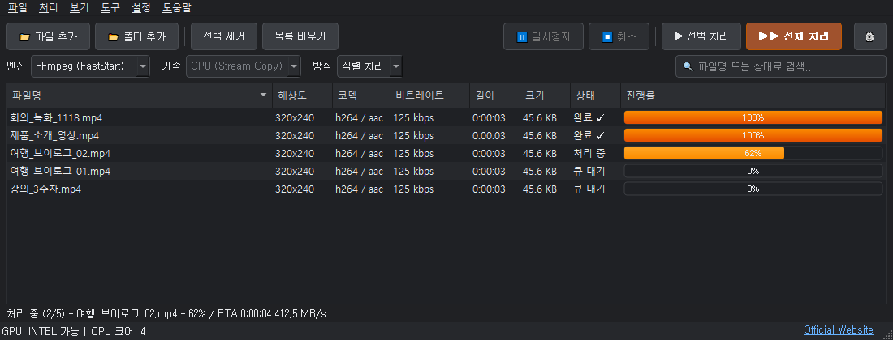
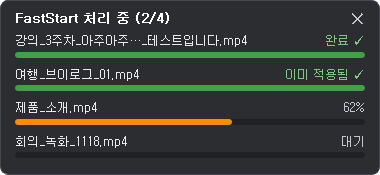

# MP4 HintBox Pro

MP4 영상을 **스트리밍에 맞게 정리**해 주는 Windows 프로그램입니다.
웹이나 스트리밍 서버에 올린 MP4가 끝까지 내려받아야 재생되는 문제를 FastStart 처리로 해결하고,
RTSP 스트리밍 서버용 Hint Track 도 만들 수 있습니다.

- 홈페이지: https://www.mp4hintbox.co.kr
- 최신 버전: **v2.1.0** (2026-11-19) · 변경 내역은 [CHANGELOG.md](CHANGELOG.md)



---

## 무엇을 해 주나요?

| 작업 | 설명 |
|---|---|
| **FastStart** | 파일 끝에 있는 `moov`(재생 정보) 블록을 맨 앞으로 옮깁니다. 브라우저와 플레이어가 다운로드 도중에도 바로 재생을 시작할 수 있게 됩니다. 재인코딩이 없어 화질 손실이 없습니다. |
| **Hint Track** | MP4Box 로 RTP/RTSP 스트리밍용 힌트 트랙을 추가합니다. (일반판 전용) |
| **진단** | stts / ctts / elst 등 타이밍 정보를 분석해 VFR(가변 프레임), B 프레임, 싱크 어긋남 여부를 보여 줍니다. |

## 주요 기능

- **Native FastStart**: FFmpeg 를 거치지 않고 moov 블록을 직접 옮겨 디스크 속도만큼 빠르게 처리 (FFmpeg 대비 2~5배)
- 특수한 구조(fragmented MP4, 다중 mdat 등)는 자동으로 FFmpeg 로 넘겨 안전하게 처리
- 파일별 진행률, 속도, 남은 시간 실시간 표시 / 일시정지, 재개, 취소
- 직렬 또는 병렬 처리, 폴더 드래그 앤 드롭 시 하위 폴더까지 자동 추가
- 출력 방식 선택: 원본 덮어쓰기(안전한 원자적 교체) / 별도 폴더 / 같은 폴더에 접미사
- 처리 결과를 ffprobe 로 검증한 뒤에만 원본을 교체, 원본 수정 날짜 유지
- GPU 트랜스코드 (NVIDIA NVENC / Intel QSV / AMD AMF, 일반판)
- 작업이 끝나면 화면 오른쪽 아래에 알림이 떴다가 3초 후 사라짐
- **탐색기 우클릭 "FastStart 처리하기"**: 프로그램 창을 열지 않고 바로 처리 (아래 참고)


## 우클릭으로 바로 FastStart

탐색기에서 MP4 / M4V / MOV 파일을 선택하고 마우스 오른쪽 버튼 > **FastStart 처리하기** 를 누르면,
프로그램 전체 창 대신 화면 오른쪽 아래에 작은 창이 떠서 파일명과 진행률만 보여 줍니다.
모두 끝나면 완료 표시 후 저절로 닫힙니다.



- 여러 파일을 한꺼번에 선택해도 창 하나에 모아 차례로 처리합니다.
- 출력 방식(덮어쓰기 / 별도 폴더 / 접미사), 수정 날짜 유지 등은 프로그램 설정을 그대로 따릅니다.
- 이미 FastStart 가 적용된 파일은 "이미 적용됨" 으로 건너뜁니다. 실패한 파일은 이유를 볼 수 있게 창이 조금 더 오래 남습니다.
- 설치할 때 "우클릭 메뉴 추가" 항목으로 켜고 끌 수 있습니다. Windows 11 에서는 "더 많은 옵션 표시" 안에 나타납니다.

## 다운로드와 설치

v2.0.9 부터 **설치형**으로 배포합니다. 설치 프로그램은 홈페이지에서 받을 수 있습니다.

| 설치 파일 | 크기 | 포함 내용 | 이런 분께 |
|---|---|---|---|
| `MP4_HintBox_Pro_Setup_v2.1.0.exe` | 약 118 MB | FFmpeg 9.0.2, ffprobe, MP4Box 동봉 | Hint Track, GPU 트랜스코드, 출력 검증까지 모두 필요한 경우 |
| `MP4_HintBox_Pro_Tiny_Setup_v2.1.0.exe` | 약 29 MB | 외부 도구 없음 (순수 Python) | FastStart 만 빠르게 하고 싶은 경우 |

- Windows 10 / 11 (64비트)
- 관리자 권한이 없으면 "현재 사용자만" 설치를 선택할 수 있습니다.
- 설정과 로그는 `%LOCALAPPDATA%\MP4HintBoxPro` (Tiny 는 `MP4HintBoxProTiny`) 에 저장됩니다.

### 일반판과 Tiny 판 비교

| | 일반판 | Tiny |
|---|:---:|:---:|
| FastStart (Native) | ✓ | ✓ |
| 특수 구조 파일 FFmpeg 폴백 | ✓ | ✗ (처리 불가로 표시) |
| Hint Track (MP4Box) | ✓ | ✗ |
| GPU 트랜스코드 | ✓ | ✗ |
| ffprobe 출력 검증 | ✓ | 자체 구조 검증 |
| 파일 진단 | ✓ | ✓ |
| 우클릭 FastStart | ✓ | ✓ |

## 사용 방법

1. **파일 추가** 또는 **폴더 추가**를 누르거나, MP4 파일이나 폴더를 목록에 끌어다 놓습니다.
2. 엔진(FastStart / Hint Track)과 처리 방식(직렬 / 병렬)을 고릅니다.
3. **▶▶ 전체 처리**(F5) 또는 **▶ 선택 처리**(Ctrl+R)를 누릅니다.
4. 이미 처리된 파일은 "이미 처리됨"으로 건너뜁니다.

| 단축키 | 동작 |
|---|---|
| `Ctrl+O` / `Ctrl+Shift+O` | 파일 추가 / 폴더 추가 |
| `F5` / `Ctrl+R` | 전체 처리 / 선택 처리 |
| `Space` / `Esc` | 일시정지·재개 / 취소 |
| `Delete` | 선택 항목 목록에서 제거 |
| `Ctrl+D` | 파일 진단 |
| `Ctrl+L` | 처리 로그 보기 |
| `Ctrl+,` | 환경설정 |

## 소스에서 실행하기

```powershell
pip install PyQt5 psutil
python mp4hint_2.0.0.py        # 일반판 (ffmpeg.exe, ffprobe.exe, mp4box.exe 를 같은 폴더나 PATH 에 두어야 함)
python mp4hint_2.0.0_tiny.py   # Tiny 판 (외부 도구 불필요)
```

## 설치 파일 빌드

필요한 것: Python 3, `pip install pyinstaller PyQt5 psutil`, [Inno Setup 6](https://jrsoftware.org/isinfo.php)

일반판 빌드에는 프로젝트 폴더에 `ffmpeg.exe`, `ffprobe.exe`, `mp4box.exe` 와 GPAC DLL 들이 있어야 합니다. (저장소에는 포함하지 않음)

```powershell
powershell -ExecutionPolicy Bypass -File installer\build_installer.ps1            # 일반판 + Tiny
powershell -ExecutionPolicy Bypass -File installer\build_installer.ps1 -TinyOnly  # Tiny 만
```

결과물은 `build_out\installer\` 에 생성됩니다. 버전은 소스의 `APP_VERSION` 값을 자동으로 사용합니다.

## 저장소 구성

| 파일 | 내용 |
|---|---|
| `mp4hint_2.0.0.py` | 일반판 소스 |
| `mp4hint_2.0.0_tiny.py` | Tiny 판 소스 |
| `installer/` | 설치 프로그램 스크립트 (Inno Setup) 와 빌드 스크립트 |
| `mp4hint.py` | 구버전(v1.x) 소스, 참고용 |
| `CHANGELOG.md` | 버전별 변경 내역 |

## 라이선스

이 프로그램의 소스는 [GPL v3](LICENSE) 를 따릅니다.
일반판에 동봉되는 [FFmpeg](https://ffmpeg.org) (GPL 빌드, [gyan.dev](https://www.gyan.dev/ffmpeg/builds/) 배포본) 와
[GPAC MP4Box](https://gpac.io) (LGPL) 는 각 프로젝트의 라이선스를 따릅니다.

© 2026 EV7lab
